# Blacktape Desktop — Complete Download UX & Edge-Case Audit (Codex Working Spec)

> **Temporary Codex Handoff Document** — Read this entire file before planning or editing. Delete this file once all fixes are complete and before committing/merging.

**Branch:** `feat/download-system-overhaul-and-torrents`

**QA Environment:** Live `dev:fresh` build tested against `Z:\blacktape-fresh-lib` (162 tracks across 7 artists: Aphex Twin, Car Seat Headrest, Chris Christodoulou, Heaven Pierce Her, Nirvana, Poppy, The Doors).

**Active Torrent Indexers During QA:** `archive`, `knaben`, `api_bay`, `solid_torrents`, `rutor` (`ru_tracker` disabled).

---

## Working Rules for Codex (`AGENTS.md`)

- Follow `AGENTS.md` strictly:
  - Write unit tests for every bug fix (a test that fails without the fix) and new feature.
  - After edits, run `npm run build`, `npm test`, `cargo check --all-targets`, and `cargo test` (in `src-tauri`) and verify zero new warnings/dead exports (`npx knip`).
  - Search for `\.actionName\b` when modifying Zustand store actions.
  - Keep `src-tauri/capabilities/` minimal and never kill external Blacktape processes (`npm run dev:fresh:stop` or check `src-tauri\target`).
- Recommended execution order: tackle by **Milestone** (below), verifying tests after each milestone rather than making one giant unverified change.

---

## Suggested Implementation Milestones

1. **Milestone 1 — Process, Engine & Disk Integrity (Bugs 1.1, 1.4, 1.8, 2.7):**
   - Abort/remove active `rqbit`/torrent handles and delete `.temp/torrents/job-*` & `staged-*` directories on task cancel.
   - Cancel active/queued album downloads when deleting an album (`Remove from app` / `Move to Trash`).
   - Serialize `check_youtube` (`"youtube-account-check"` webview) with an async mutex/lock so concurrent checks never collide.
   - Clean up empty `.temp/batch_*` dirs on download failures and remove orphaned `cover.jpg`/empty album directories on `Delete Album` / `Empty Trash`.
2. **Milestone 2 — Track Matching, Platform Overrides & Quality Labels (Bugs 1.2, 1.3, 1.5, 1.6, 1.7):**
   - Fix `select_tracks` running after `apply_download_overrides_with_format` mutates `track.url` in `src-tauri/src/download/album.rs:916-953`.
   - Pass explicit `trackUrls`/`expected` from `ArtistAlbums.tsx:636-649` into `Download missing as...` so canonical missing tracks match properly instead of falling back to 70-track box sets and hiding YouTube options.
   - Fix `tierDisplayLabel` (`MP3 (Lossless)`) in `src/features/download-quality/lib/downloadQuality.ts:110-122`.
   - Fix `Endless, Nameless` (`6:43`) mis-matching `Territorial Pissings` (`2:23`) during multi-track/torrent import (`Nirvana - Nevermind` combined MB track 12 vs local 12+13).
   - Fix `AlbumPreview` `Upgrade audio quality` silent no-op loop (`src-tauri/src/download/track.rs:67-115` ignoring album-discovered FLAC sources & emitting `"Already at the best available quality"` silently).
3. **Milestone 3 — Cross-Platform Quick/Menu Discovery, Streaming Playback Bug & Default Quality Setting (Bugs 1.10, 2.1–2.3, Part 4):**
   - Reproduce and fix owned `FLAC · Lossless` tracks in `Nirvana - Nevermind` (`04 Breed`) playing via `STREAMING` when `missingById.size > 0` (`ArtistAlbums.tsx:790-793`, `422-431`).
   - Make `Download as...` on single/missing tracks discover across **all platforms** (YouTube, Bandcamp, SoundCloud, Torrents), returning fast results within ~5–7s while streaming slower torrent indexers progressively into `QualityModal` instead of blocking on `"Checking more releases..."`. Improve torrent search accuracy/speed for 1–few missing songs from `ArtistAlbums`.
   - Add `"Download N missing songs as…"` to multi-selected missing-track context menu (`ArtistAlbums.tsx:450-459`).
   - Make quick one-click `Download` resolve cross-platform toward the user's configured default quality tier instead of strictly the linked platform.
   - Add **Default Download Quality Tier** setting in **Settings -> Downloader** and an onboarding step in **WelcomeModal**, with clear fidelity vs storage-size explanations.
4. **Milestone 4 — UI State, Selection & React Keys (Bugs 1.9, 2.4–2.6, Track Number / Discovery Sync):**
   - Deduplicate `ArtistAlbums` active download album cards & React keys (`heaven pierce her::flowerworks`) when multiple single-track downloads run concurrently.
   - Keep `Go to album` active when `Select all` is clicked on a fully owned album.
   - Disambiguate duplicate options in Track Candidate Dropdown (include release title / indexer / seeders) & `QualityModal` (`hi_res` vs `lossless`), and fix horizontal scrollbar overflow in `AlbumPreview`.
   - Stop `Edit` -> `Done` in `AlbumPreview.tsx:100-115` from re-querying torrents with edited fake metadata and deduplicate `QualityModal` discovery vs `AlbumPreview`.
   - Ensure torrent-downloaded single tracks write/display track numbers (`04 Sunshine (Mirage)`) immediately and `albums` state refreshes promptly on completion.
5. **Milestone 5 — Visual Truncation, Layout Shift & Modal/Banner Polish (Part 3).**
6. **Milestone 6 — Slow / Seedless Torrent Fallback & Background Seed Watch (Part 6):**
   - Detect torrents stuck at 0 bytes / no active seeds after ~20–30s (`TORRENT_FIRST_BYTE_TIMEOUT` / `TORRENT_STALL_TIMEOUT` in `src-tauri/src/torrent/download.rs`) instead of blocking up to ~50s before failing.
   - For automatic `"Best available"` downloads, automatically fall back to the next-best available source (HTTP stream or healthy torrent) and optionally offer/queue a background seed watch.
   - For explicit user-selected torrent downloads, surface an inline suggestion on the task (`"No active seeds yet — Try another source"` + `"Watch in background"`), downloading the fallback now and upgrading later if seeds appear.
   - Clean up `.temp/torrents/job-*` between background checks and cancel any active seed-watch when the user cancels, deletes/trashes the album, or switches Default Download Quality away from `"best"`.

---

## Part 1: Critical & High Bugs

### 1.1 Cancelling an active torrent does not stop the torrent engine or clean temp files `[CRITICAL]`
- **Observed Path:** `ArtistAlbums` -> `Nirvana` -> `Nevermind` -> `Re-download / Upgrade album…` -> `TORRENT FLAC (Lossless)` (`~431 MB · 136 seeders`) -> `LeftSidebar` hover `X` -> `Cancel Download`.
- **What Happened:** Even after `Cancel Download` logged `Cancelling download task task_id=f17d8551-...` at `18:20:34`:
  1. `torrent id=0` kept downloading to completion at `18:20:47` (`torrent finished downloading`).
  2. UDP tracker announcements continued (`18:21:34`, `18:22:44`, `18:23:54`) until the app exited.
  3. `Z:\blacktape-fresh-lib\.temp\torrents\job-8ef82fbc-a2f2-43f9-88e1-cf6fe0514241` remained on disk using **276.01 MB**, alongside older orphaned `job-*` / `staged-*` dirs (`419+ MB` total across `job-9977aca2...`, `job-cc1198d2...`, `staged-*`).
- **Expected:** Cancelling a torrent download must abort/remove the active torrent handle in the torrent manager immediately and delete its `.temp/torrents/job-*` / `staged-*` directory.

### 1.2 Single missing-track `Download as...` fails across platforms with `"None of the selected tracks was found in the album."` `[CRITICAL]`
- **Observed Path:** `ArtistAlbums` -> `Heaven Pierce Her` -> `ULTRAKILL: CHAOS/ORDER` -> `Show missing songs` -> Right-click Track 04 (`Sunshine (Mirage)`) -> `Download as...` -> `YouTube Opus 160 kbps`.
- **Root Cause:** `src-tauri/src/download/album.rs:916-953` calls `apply_download_overrides_with_format(&mut album_info, overrides, effective_format)` (mutating `track.url` to the candidate's overridden platform URL) **before** `select_tracks(tracks, selected)` tries to match `selected` (which still holds the original primary URL).
- **Additional Symptom:** On `MissingTrackRow`, right-click `Download as...` opens an album-titled `QualityModal` (`ULTRAKILL: CHAOS/ORDER`) instead of the track title and bypasses `missingTracksStore.failures` (shows top red banner, no row `(!)` icon).

### 1.3 `ArtistAlbums` -> `Download missing as...` (`canonical:` albums) matches wrong 70-track box sets & drops YouTube `[CRITICAL]`
- **Observed Path:** `ArtistAlbums` -> `Nirvana` -> `Nevermind` (linked to MusicBrainz 12-track release) -> Album context menu -> `Download missing as…`.
- **What Happened:** `QualityModal` showed wrong `70/70 tracks · ~490 MB` and `13/70 tracks · ~2.0 GB` releases and omitted all 12 YouTube Opus options.
- **Root Cause:** `src/pages/artist-albums/ArtistAlbums.tsx:636-649` calls `openQualityMenu({ platform: source.platform, downloadType: ItemType.Album, url: source.source_url, artistName: selectedTab, title: album.title }, ...)` **without** passing `trackUrls` / `expected`. When `albumPreviewStore.preview?.url !== params.url`, `src/features/download-quality/ui/QualityModal.tsx:138-143` falls back to `expected: []`, and `src/features/download-quality/lib/downloadQuality.ts:214` (`if (tracks.length === 0)`) builds track rows from arbitrary torrent matches.

### 1.4 Deleting an album while its download is active lets the download finish and resurrect the album `[HIGH]`
- **Observed Path:** `ArtistAlbums` -> `Heaven Pierce Her` -> `ULTRAKILL: CHAOS/ORDER (Edited)` -> Start `Download missing (1)` (`Sunshine (Mirage)`) -> While `Downloading 0%`, right-click album -> `Delete Album...` -> `Move to Trash`.
- **What Happened:** Album vanished from `ArtistAlbums`, while `LeftSidebar` kept spinning `Downloading... 0%` with the deleted album cover. ~7s later, the Bandcamp download completed (`FLAC · Lossless`) and recreated `ULTRAKILL: CHAOS/ORDER 2021` on disk with `04 Sunshine (Mirage)` and `Show 3 missing songs`.
- **Expected:** Deleting an album (`Remove from app` or `Move to Trash`) must cancel active/queued downloads for that album.

### 1.5 Torrent import downloaded `"Territorial Pissings"` (2:23) in place of `"Endless, Nameless"` (6:43) `[HIGH]`
- **User Report & Screenshot Evidence:** In `Nirvana -> Nevermind`, both `07 Territorial Pissings` (`FLAC · Lossless`) and `Endless, Nameless` (`FLAC · Lossless`, unnumbered) play for **`2:23`** (instead of `6:43` for `Endless, Nameless`).
- **Context:** MusicBrainz `Nevermind` combines track 12 into `"Something in the Way / Endless, Nameless"` (`20:35`), misaligning local Track `13 Endless, Nameless` (`6:43`) against 12-track torrent/Archive releases during track matching.

### 1.6 `"MP3 (Lossless)"` contradiction in Torrent Quality Picker `[HIGH]`
- **User Report & Screenshot Evidence:** `QualityModal` for `Nevermind · Nirvana · YouTube` displays **`TORRENT MP3 (Lossless)` (`24/24 tracks · ~400 MB · Archive.org`)**.
- **Root Cause:** In `src/features/download-quality/lib/downloadQuality.ts:110-122`, `tierDisplayLabel` checks `if (tier === "lossless") return `${displayCodec} (Lossless)`;`. When an Archive.org / torrent release reports `codec: "MP3"` (dominant/sampled tag on mixed FLAC+MP3 items) alongside `tier: "lossless"`, the formatter renders `MP3 (Lossless)`.

### 1.7 `AlbumPreview` `Upgrade audio quality` silently fails as an infinite no-op loop `[HIGH]`
- **Observed Path:** `AlbumPreview` -> `Heaven Pierce Her - ULTRAKILL: CHAOS/ORDER` (tracks 1–3 FLAC, track 4 MP3 · High locally, all 4 rows showing `P2P · FLAC · Lossless`) -> Click `Upgrade audio quality`.
- **What Happened:** Button flashed `Upgrading 0%`, `LeftSidebar` flashed `0%`, then finished immediately with Track 04 still `.mp3` on disk, zero toast/error banner, and `Upgrade audio quality` still enabled.
- **Root Cause:** `src-tauri/src/download/track.rs:67-115` calls `resolve_candidates_for_track` (`HighLossy` only when album lossless overrides aren't used), logs `"Skipping single-track upgrade: local file already has equal or higher quality"`, emits `"Already at the best available quality"` via `ProgressEvent`, and exits `Ok` with no user-visible feedback.

### 1.8 Concurrent YouTube account check fails with `webview with label 'youtube-account-check' already exists` `[HIGH]`
- **User Report & Screenshot Evidence:** `Find missing songs` displays: `"Endless, Nameless" could not be downloaded. Could not open the check window: a webview with label 'youtube-account-check' already exists Try again, or pick another version or source for this song.`
- **Root Cause:** `src-tauri/src/auth/account.rs:186-243` (`check_youtube`) lacks an async mutex/lock serializing `CHECK_WINDOW` (`"youtube-account-check"`). Concurrent calls race on async `stale.destroy()` / `WebviewWindowBuilder::new(app, CHECK_WINDOW, ...).build()`. Also fix missing period between `"already exists"` and `"Try again..."` and add button styling to recovery dialog actions (`Try again`, `Only this song from another platform`, `Cancel`).

### 1.9 Concurrent single-track downloads for the same album trigger duplicate React keys & split cards `[HIGH]`
- **Observed Path:** `AlbumPreview` -> `Heaven Pierce Her - Flowerworks` -> Quick-download Track 01 then Track 02 individually.
- **What Happened:** Emitted 15+ React `Encountered two children with the same key` (`heaven pierce her::flowerworks`) console errors and rendered two stacked split album cards in `ArtistAlbums` (Card 1: `2018`, `01 Sea of Thoughts 14%`; Card 2: missing year, `01 Starting download... 0%`).

### 1.10 Owned FLAC tracks in `Nevermind` playing via `STREAMING` `[HIGH]`
- **User Report & Screenshot Evidence:** *"it's just streaming even downloaded songs for some reason here, fine in other albums."* Screenshot shows `Nirvana -> Nevermind` Tracks `01`–`11` as `FLAC · Lossless` (`04 Breed` paused at `0:00 / 3:03`), while `In Utero` Track `12 All Apologies` is expanded as missing above it, and the Now Playing bar displays `STREAMING Nirvana · Nevermind · 1991`.
- **Observed Code Path:** In `src/pages/artist-albums/ArtistAlbums.tsx:790-793` and `422-431`, whenever any album on the artist page has shown missing rows (`missingById.size > 0`), playing any owned song routes through `playFromRow` -> `start_mixed_playback` (`src-tauri/src/preview/commands.rs:300-338`) across all artist rows instead of `handlePlaySong`. Reproduce whether `mixedEntries` built a stream entry or `src-tauri/src/audio/player.rs:1185` retained stale stream state.

---

## Part 2: Medium Bugs & Missing Capabilities

### 2.1 Single-track `Download as...` only searches the linked platform & torrent search blocks instead of streaming fast results `[MEDIUM]`
- **User Notes & Screenshots:**
  - `Endless, Nameless · Nirvana · YouTube` `Download quality` modal (`MissingTrackRow` `Download as...`) shows ONLY YouTube formats (`Opus 120`, `AAC 130`, `Opus 59`, `Opus 45`) instead of checking **all platforms** (YouTube, Bandcamp, SoundCloud, Torrents) immediately even for 1 song.
  - `In Utero · Nirvana` `Download quality` modal shows `YOUTUBE High Quality`, `BANDCAMP Standard Quality`, and `TORRENT Checking more releases... Matching torrent files...`: torrent discovery waits for all indexers/releases rather than returning initial platform options within ~5–7 seconds and progressively streaming torrent results as they resolve.
  - Torrent search from `ArtistAlbums` for 1 or a few missing songs works poorly compared to full-album preview discovery.

### 2.2 Multi-select on missing songs lacks `"Download N missing songs as…"` `[MEDIUM]`
- **Observed Code Cause:** `src/pages/artist-albums/ArtistAlbums.tsx:450-459` (`mixedMenuItems`) only adds `Download ${missing.length} missing song(s)` (automatic `downloadMissingMany`), whereas owned multi-selection (`493-534`) provides `Re-download / Upgrade N downloaded tracks…` -> `openQualityMenu`. Add `"Download N missing songs as…"`.

### 2.3 Quick `Download` button ignores cross-platform best/preferred quality `[MEDIUM]`
- **User Note:** One-click `Download` should target the best available / user-configured quality across platforms rather than blindly using whichever platform the album or missing track happens to be linked to (`YouTube` / `Bandcamp`).

### 2.4 `Select all` on a fully owned album switches `Go to album` back to `Download album` `[MEDIUM]`
- **Observed Path:** `AlbumPreview` -> `Poppy - I Disagree` (all 10 tracks owned locally, `✓ Downloaded`, row context menu disabled `Downloaded`) -> Click `Select all` switches the primary blue `Go to album` button back to `Download album`.

### 2.5 Duplicate indistinguishable options in Candidate Picker & `QualityModal` + Horizontal Scroll Clipping `[MEDIUM]`
- Per-track candidate dropdown shows two identical `Torrent · MP3 320 kbps / Exact match · 320 kbps` items with no release title, indexer, or seeder distinction.
- `QualityModal` shows two identical `TORRENT FLAC (Lossless)` options when `hi_res` and `lossless` format identically.
- Opening `Select quality` (`AlbumQualityPicker`) triggers horizontal overflow scrollbar clipping at bottom of `AlbumPreview`.

### 2.6 `AlbumPreview` `Edit` -> `Done` wipes and re-queries torrent indexers with edited metadata `[MEDIUM]`
- Toggling `Edit` -> `Done` flips `torrentScope` in `src/pages/album-preview/AlbumPreview.tsx:100-115`, wiping previous discovery and querying torrent indexers using edited test names (`Poppy Edited`), while opening `QualityModal` triggers yet another duplicate torrent discovery pass.

### 2.7 Temp directory & cover image cleanup gaps `[MEDIUM]`
- Failed YouTube sign-in download left empty `Z:\blacktape-fresh-lib\.temp\batch_1795715916901` on disk (while Bandcamp cancel cleaned up `.temp\batch_1795716259042`).
- `Delete Album...` -> `Empty Trash` removed tracks cleanly but left `cover.jpg` orphaned inside `Z:\blacktape-fresh-lib\Heaven Pierce Her\ULTRAKILL CHAOS ORDER`.

---

## Part 3: UX & Visual Polish Issues

1. **Header & Year Over-Truncation at 1280×720:**
   - `AlbumPreview`: titles (`I Disa...`, `Garden of Ro...`, `ULTRAKIL...`) and metadata (`10 tr...`, `1 t...`, `2021 · 13 mi...`) over-truncate because Edition pill + Source badge + Checkmark share the header row.
   - `ArtistAlbums`: 4-digit year truncates (`20...`, `2...`) whenever `Show N missing songs` or `Downloading 0%` shares the title row.
2. **Tracklist Layout Jump on First Selection:**
   - Selecting any track in `AlbumPreview` inserts `"N selected"` above `DISC 1`, shifting all rows down ~24px.
3. **Contradictory / Stale Badges & Metadata:**
   - Partial download leaves `✓ Downloaded` badge right beside `Download missing tracks` in `AlbumPreview`.
   - Already-owned Track 10 (`Don't Go Outside`) on `Poppy - I Disagree` still shows yellow warning `⚠ YT · OPUS · High`.
   - Track 10 (`Clair de Lune` by `Claude Debussy`, row `⚠ YT · OPUS · High`) opens gear `QualityModal` showing album artist (`Heaven Pierce Her`) and labeling all 3 platforms `Verified candidate`.
   - Editing Track 01 title in `AlbumPreview` hides its track artist text while sibling rows keep `Heaven Pierce Her`.
   - Single torrent-downloaded `Sunshine (Mirage)` initially omitted track number `04` in `ArtistAlbums` until a view reload.
   - `Download missing (1)` (`ORDER`) left UI looking un-owned until >1.2s after task finish (scan refresh delay).
4. **Modal, Context Menu & Error Banner Friction:**
   - `CancelDownloadModal` (`src/features/library/ui/Library.tsx:109-125` + `CancelDownloadModal.tsx`) duplicates artist name on multi-downloads: `"2 downloads for Heaven Pierce Her" by Heaven Pierce Her?` (single-download wording `"Nevermind" by Nirvana?` is clean).
   - `Delete Album` modal writes `(3 tracks)` inside the quoted album title: `What do you want to do with "ULTRAKILL: CHAOS/ORDER (Edited) (3 tracks)"?`.
   - `Re-download / Upgrade album…` disables submit (`Already up to date`) instead of permitting same-quality re-download; mixed albums display yellow `"(will fall back to streams when using Best)"` under `TORRENT FLAC (Lossless)` even when Best says `"Already at equal or higher quality (no upgrade needed)"`. Footer button says `"Download ..."` instead of `"Upgrade ..."` during upgrades.
   - Failed download banner renders at the top of `ArtistAlbums` off-screen when scrolled down and bleeds into `AlbumPreview` without naming which track failed.
   - `FindMissingModal` MusicBrainz item has blank grey cover square; `Nirvana - Nevermind` local `12` + `13` vs MusicBrainz combined Track 12 produces `0 owned / 12 missing` and renders dimmed Track 12 between owned `12` and `13`; `(!)` recovery modal buttons lack button styling hierarchy.
   - Header vs context-menu label inconsistency: `Show 12 missing songs` vs `Show missing songs (12)`.
   - Opening `AlbumPreview` for an album currently downloading/upgrading in `ArtistAlbums` (e.g. `Nevermind` at `51%`) still shows `Download album` and lets you start a duplicate download.

---

## Part 4: New Feature Requirements (Default Quality Tier)

Confirmed via `src/pages/settings/` and `src/features/onboarding/` that **no default download quality tier setting exists today**:

1. **Settings -> Downloader -> Default Download Quality Tier:**
   - Persistent setting choosing what quality tier automatic one-click `Download` targets across all platforms (not restricted to the currently linked platform).
   - Explain each option clearly with **audio fidelity + approximate disk space usage** (e.g., `Lossless (FLAC / WAV)`, `High Lossy (~160–320 kbps Opus/AAC/MP3)`, `Standard Lossy (~128 kbps)`).
2. **Welcome Setup Wizard (`WelcomeModal`):**
   - Add a setup step asking new users to pick their default download quality tier with the same fidelity vs storage comparison.

---

## Part 5: Complete Action Tree Log & Diagram

### Detailed Action Tree (All Paths Exercised)
- `[ROOT]` Launch isolated `dev:fresh` (`01_initial_launch.png`)
  - `[O1]` Onboarding -> `Z:\blacktape-fresh-lib` -> Scan **162 songs / 7 artists**
  - `[S1]` Settings -> Downloader -> Torrent Indexers (`archive`, `knaben`, `api_bay`, `solid_torrents`, `rutor` enabled; `ru_tracker` disabled)
  - `[L1]` Inspect existing `ArtistAlbums`: `Nirvana` (`Nevermind` tracks 12–13 OPUS + warning), `Car Seat Headrest` (mixed FLAC/MP3/OPUS), `Heaven Pierce Her` (`FRAUD`), `Poppy` (`I Disagree` 10× MP3 High), `Aphex Twin` (`Drukqs` 2-disc FLAC)
- `[A]` **`ArtistAlbums`**
  - `[A1]` `Car Seat Headrest` -> `Re-download / Upgrade album…` (mixed quality yellow fallback warning bug)
  - `[A2]` `Poppy - I Disagree` -> `Re-download / Upgrade album…` (disabled `Already up to date`)
  - `[A3]` `Nirvana - Nevermind` -> `FindMissingModal` (blank cover, MB combined Track 12 -> `0 owned / 12 missing`) -> Expand missing -> Quick download YT cancelled -> off-screen banner + `(!)` modal + empty `.temp/batch_*`; `Download missing as…` -> wrong 70-track box set + missing YT + duplicate `TORRENT FLAC (Lossless)`
  - `[A4]` `Nirvana - Nevermind` -> `Re-download / Upgrade album…` -> `TORRENT FLAC` (136 seeders) -> Mid-upgrade UI (`ArtistAlbums`, `AlbumPreview` bleeding banner + allowing duplicate `Download album`, `LeftSidebar` `"Nirv"` filter + hover `X` + single `CancelDownloadModal`) -> Post-cancel: Track 12 swapped to FLAC, Track 13 OPUS, retry shows `1/2`, **BUT** `rqbit` finished 431.8 MB in background & left `276.01 MB` in `.temp/torrents`
  - `[A5]` `Heaven Pierce Her - CHAOS/ORDER`: Missing row `Download as...` -> YT fails (`album.rs:916` bug); Torrent MP3 succeeds (missing track `04` initially); `Download missing (1)` completes `ORDER` (>1.2s UI scan delay); `Edit Album...` (`(Edited)`, `2022`); `Delete Track` `CHAOS` -> `Move to Trash` (`20...` year trunc) -> `Restore` from Trash; single-song `Re-download / Upgrade quality…` misses FLAC & disables; `Download missing (1)` + `Delete Album...` mid-download -> resurrects album after 7s; Cleanup (`Empty Trash`, leaves `cover.jpg`)
- `[P]` **`AlbumPreview`**
  - `[P1]` `Poppy - I Disagree`: `Select quality` (x-scroll clip); per-track candidate dropdown (duplicate indistinguishable torrent items); `Select all` on fully owned album (`Go to album` -> `Download album`); Track 10 owned warning badge; Edition switch (`Original` 10 -> `More` 14 -> `QualityModal`); Metadata `Edit` -> `Done` (re-runs torrent discovery on edited name) -> `Undo changes`
  - `[P2]` `Heaven Pierce Her - Garden of Romance` (1-track Bandcamp): canonical vs Bandcamp `QualityModal`, title/meta truncation
  - `[P3]` `Heaven Pierce Her - Flowerworks`: 2 concurrent single-track Bandcamp downloads -> duplicate React keys + 2 stacked split cards in `ArtistAlbums`; `LeftSidebar` filter -> `Keep Downloading` -> `CancelDownloadModal` (duplicated artist string) -> clean `.temp/batch_*` removal
  - `[P4]` `Heaven Pierce Her - CHAOS/ORDER`: edit Track 01 title (artist disappears) -> `Ctrl+click` Tracks 1–2 -> `Download 2 of 4 tracks` (`✓ Downloaded` next to `Download missing tracks`) -> re-open -> click `Upgrade audio quality` -> silent no-op loop (`track.rs:103`)
  - `[P5]` `Heaven Pierce Her - INFINITE HYPERDEATH` (2-disc, 27 tracks, 26 selectable): `"N selected"` 24px row shift, `Shift+click`, `Ctrl+click`, `Select all` / `Clear selection`, `Esc` clears selection & `QualityModal`; Track 10 (`Clair de Lune`, `⚠`) gear `QualityModal` (wrong artist + `Verified candidate`); `confirmDownloadWithWarnings` (`Cancel` / `Download verified only (25)` / `Download anyway`)

```mermaid
flowchart TD
    ROOT["Launch dev:fresh & Scan Z:\blacktape-fresh-lib (162 songs, 7 artists)"]

    ROOT --> AP["AlbumPreview Entry (Search / Edition)"]
    ROOT --> AA["ArtistAlbums Entry (LeftSidebar Artist)"]
    ROOT --> SB["LeftSidebar Active Downloads"]

    AP --> AP_EDIT["Metadata Edit -> Done -> Undo [BUG: re-runs torrent discovery on fake names]"]
    AP --> AP_ED["Switch Edition (Original -> More: 10->14 tracks)"]
    AP --> AP_QUAL["Select Quality / Candidate Picker [BUG: duplicate entries + x-scroll clip]"]
    AP --> AP_SEL["Selection: Click / Ctrl / Shift / Select All / Esc [UX: 'N selected' shifts rows 24px]"]
    AP_SEL --> AP_SEL_OWN["Select all on fully owned [BUG: reverts 'Go to album' to 'Download album']"]
    AP_SEL --> AP_WARN["Download w/ unverified track -> Warning Modal (Cancel / Verified only / Anyway)"]
    AP --> AP_DL["Partial Download (2 of 4 tracks Bandcamp FLAC)"]
    AP_DL --> AP_CONC["2x Concurrent Track Downloads [BUG: dup React key + split ArtistAlbums cards]"]
    AP --> AP_UPG["Upgrade audio quality (CHAOS/ORDER mixed MP3+FLAC) [BUG: silent no-op via track.rs]"]
    AP --> AP_GEAR["Row Gear -> QualityModal [UX: shows album artist & 'Verified' on warned track]"]

    AA --> AA_MB["FindMissingModal (MB Link -> Duplicated / 0-owned edge on combined Track 12)"]
    AA --> AA_MISS["Expand Missing Rows"]
    AA_MISS --> AA_QUICK["Quick Download -> YT Sign-in Cancelled -> (!) Modal + Banner [BUG: empty .temp dir]"]
    AA_MISS --> AA_TRK_AS["Missing Row 'Download as...' -> Cross-platform [BUG-CRIT: track not found in album]"]
    AA_MISS --> AA_ALB_AS["Album 'Download missing as...' -> Wrong 70-track box set + hides YT [BUG-CRIT]"]
    AA_MISS --> AA_DL1["Download missing (1) -> Bandcamp FLAC finishes & clears missing state"]
    AA --> AA_REDL["Re-download / Upgrade album..."]
    AA_REDL --> AA_EQ["Equal quality album -> 'Already up to date' blocks Re-download [UX]"]
    AA_REDL --> AA_TOR["Nirvana Nevermind -> TORRENT FLAC (136 seeders) -> Track 12 upgrades, Track 13 mid-flight"]
    AA --> AA_MOD["Edit Album... -> Saves tags & keeps MB link"]
    AA --> AA_DEL_TRK["Delete Track -> Move to Trash -> Missing song reappears [UX: '20...' year trunc]"]
    AA_DEL_TRK --> AA_TRASH["Hamburger -> Trash -> Restore Icon -> Track returns cleanly"]
    AA --> AA_DEL_DL["Delete Album WHILE Downloading [BUG-HIGH: download finishes & resurrects album]"]

    SB --> SB_FILT["Filter 'Search artists...' while downloading"]
    SB --> SB_HOV["Hover progress ring -> Red 'X' -> CancelDownloadModal"]
    SB_HOV --> SB_KEEP["Keep Downloading -> Continues cleanly"]
    SB_HOV --> SB_CANC_MULTI["Cancel Multi-Download [UX: duplicated artist name] -> .temp/batch cleaned"]
    SB_HOV --> SB_CANC_TOR["Cancel Torrent [BUG-CRIT: rqbit keeps downloading 431MB + leaves 276MB .temp]"]
    SB_CANC_TOR --> SB_RETRY["Post-cancel Re-download / Upgrade -> Retries cleanly for remaining 1/2 tracks"]
```

---

## Part 6: Slow / Seedless Torrent Fallback & Background Seed Watch (Milestone 6)

### Context
In `src-tauri/src/torrent/download.rs`, a torrent currently waits `TORRENT_INIT_TIMEOUT` (`25s`) + `TORRENT_FIRST_BYTE_TIMEOUT` (`25s`) and retries once without DHT (~`50s` total) before failing with `"Timed out waiting for the selected torrent to send data."` (or `45s` on a mid-transfer stall). When a torrent has no active/free seeds, the user is stuck waiting nearly a minute with no fallback or feedback.

### Requirements
1. **Explicit Torrent Picks (`Download as…` → `TORRENT`):**
   - If a torrent receives `0` bytes after ~25–30s, emit a task warning/action state (`"No active seeds yet"`) instead of silently blocking until total timeout.
   - Offer non-blocking inline actions on the download card / sidebar task:
     - **Try another source now**: aborts the stalled torrent handle, cleans up `.temp/torrents/job-*`, and immediately downloads from the next-best fallback source (`YouTube` / `Bandcamp` / `SoundCloud` or another healthy torrent).
     - **Watch in background** (combined with fallback or standalone): downloads the fallback source now so the tracks are usable immediately, and queues a lightweight periodic background seed watch that upgrades the tracks to lossless in place if seeds become available later.
2. **Automatic Quick Downloads (`Default Download Quality Tier = "best"`):**
   - If the top torrent gets `0` bytes after ~15–20s, automatically fall back to the next-best healthy source (`fallback_urls` / HTTP stream) and notify the user (e.g. `"Torrent had no active seeds; downloaded Opus 160 kbps"` with an optional `"Watch for lossless"` action).
3. **Resource & Lifecycle Safety:**
   - Background seed watches must perform short, timed peer/tracker checks and clean up any `.temp/torrents/job-*` / `rqbit` handles between probes rather than keeping active sessions open indefinitely.
   - Cancelling a download, deleting/trashing the album or track, manually upgrading a track, or changing Default Download Quality away from `"best"` must immediately cancel any associated background seed watch.
