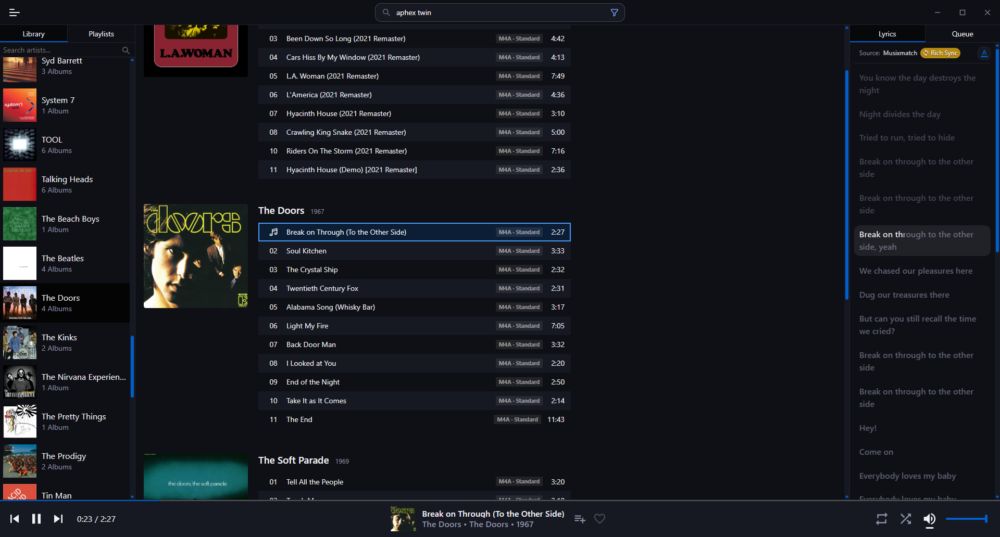
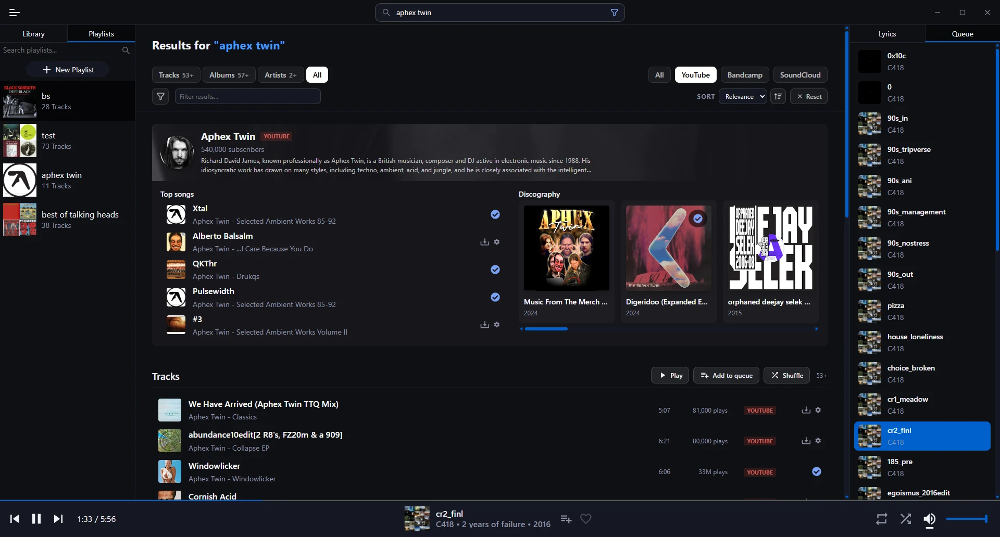
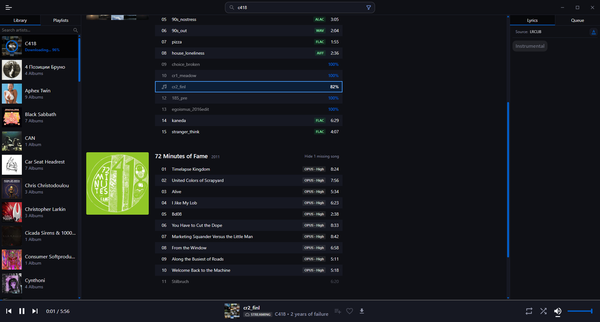
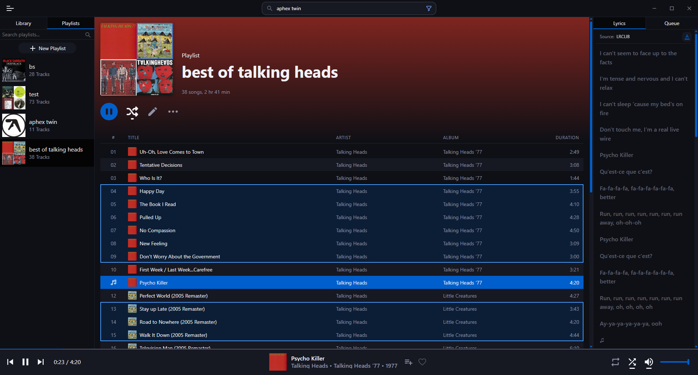
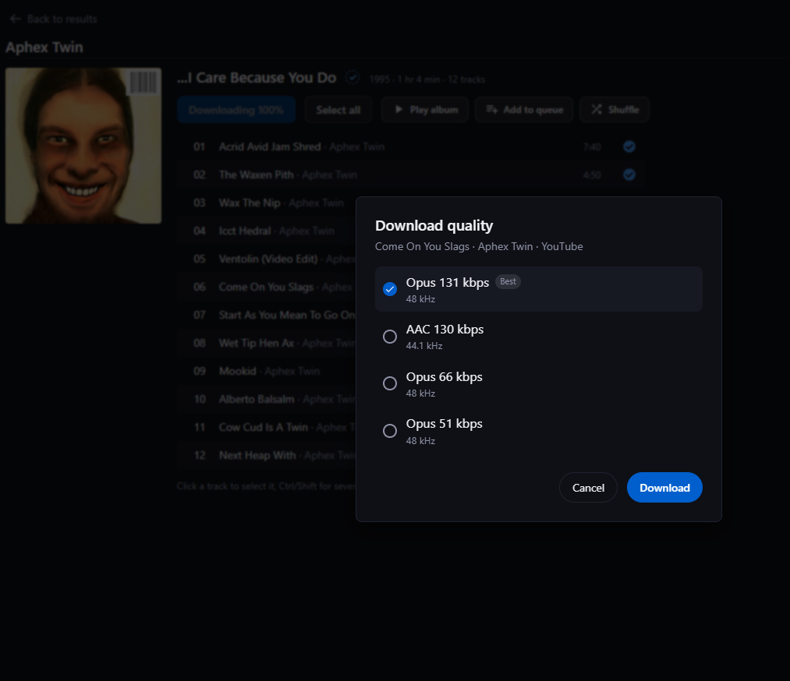
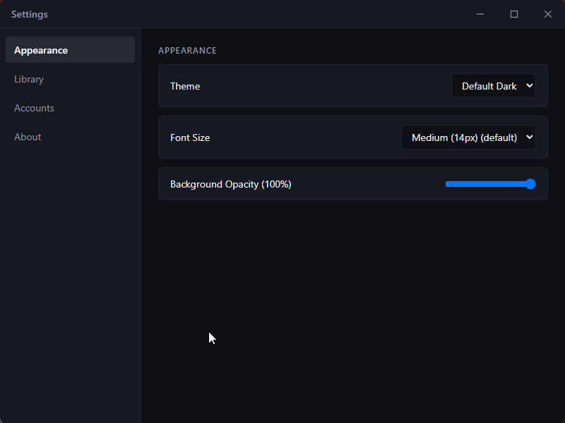

# Blacktape Music Player

**Your music library and every music site, in one app.** Search YouTube, Bandcamp and SoundCloud, listen right away, and download the good stuff straight into your library.

Most players only play what you already have, and most downloaders don't care about your library. Blacktape does both, so you don't need to manually download and organize your music.





<details>
<summary>More screenshots</summary>









</details>

## What it does

- **Search everywhere.** YouTube, Bandcamp and SoundCloud from one search bar.
- **Listen first.** Stream any result before you download it.
- **Pick the quality.** See the FLAC, MP3 and Opus options before you download a track or a whole album.
- **See what's missing.** Finds the tracks of an album you don't have yet, and better versions of the ones you do.
- **Synced lyrics.** Scrolls along with the song when it can find them, and you can edit them.
- **A tidy library.** Playlists, tag editing for songs and albums, and a trash you can restore from.
- **The basics done right.** Gapless playback, media keys, Discord status and updates from inside the app.

## Download

Windows builds are on the [Releases page](https://github.com/seafoodd/blacktape-desktop/releases). Other systems are not built yet, so for now you'd need to run it from source.

The app downloads [yt-dlp](https://github.com/yt-dlp/yt-dlp) and [ffmpeg](https://ffmpeg.org), which are required for downloading songs.

## Run from source

You need [Node.js](https://nodejs.org) and [Rust](https://rustup.rs), plus whatever Tauri needs on your system ([prerequisites](https://tauri.app/start/prerequisites/)).

```
git clone https://github.com/seafoodd/blacktape-desktop
cd blacktape-desktop
npm install
npm run tauri dev
```

Tests:

```
npm test
cd src-tauri && cargo test
```

## Built with

- [Tauri 2](https://tauri.app) with a Rust backend: audio with [rodio](https://github.com/RustAudio/rodio) and Symphonia, tags with [lofty](https://github.com/Serial-ATA/lofty-rs), SQLite through sqlx, [souvlaki](https://github.com/Sinono3/souvlaki) for media controls
- React 19, TypeScript, Zustand and Vite on the frontend
- [yt-dlp](https://github.com/yt-dlp/yt-dlp) and [rustypipe](https://codeberg.org/ThetaDev/rustypipe) for getting tracks from the sites

## Status

This is a personal project, still in development. Things will change and break, so back up your library before you try it on one you care about.

## Contributing

Contributions are welcome, but I may not review or merge everything. By sending a contribution you agree that it is licensed under GPL-3.0-only.

## License

Blacktape is licensed under the [GNU General Public License v3.0 only](./LICENSE) (`GPL-3.0-only`). Versions published before this change were released under the MIT License.

## Disclaimer

Blacktape is meant for personal use with content you have the right to access. You are responsible for following the terms of the platforms you use and the copyright laws of your country. The author does not host or distribute any music.
